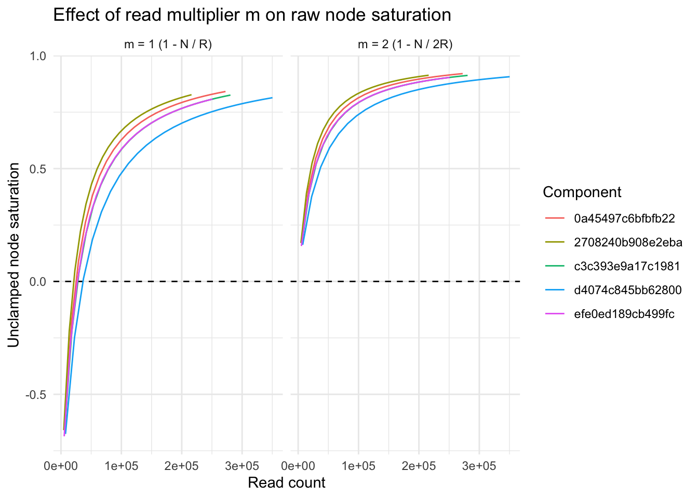
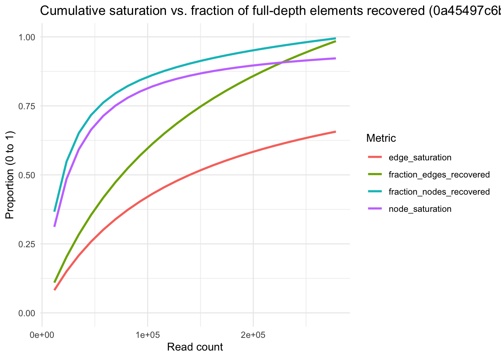
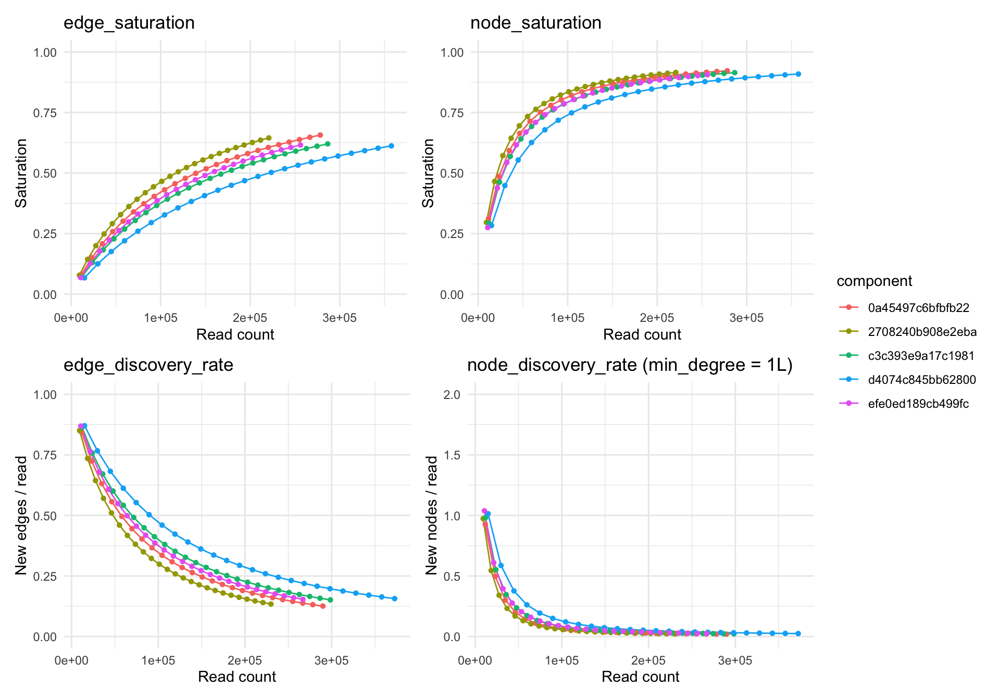
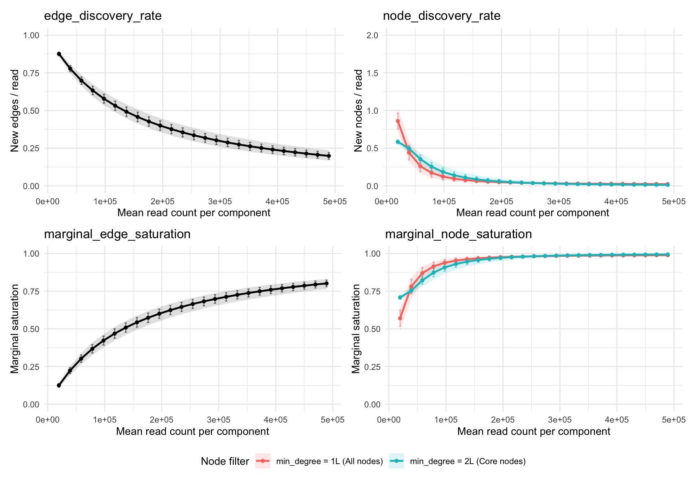

# Sequencing Saturation and Discovery Rates in PNA Data

## Introduction and motivation

Sequencing saturation is used to answer two practical questions about a
sequencing library:

1.  **What fraction of my reads are PCR duplicates rather than new
    molecules?**
2.  **How much new biological information would I gain by sequencing
    deeper?**

In standard single-cell assays (such as scRNA-seq), each sequencing read
observes a single molecule (UMI), and saturation is defined as:

``` math
S = 1 - \frac{U}{M}
```

where $`U`$ is the number of unique elements observed and
$`M = \sum_{i=1}^{U} m_i`$ is the total number of element observations.

In Proximity Network Assays (PNA), **the physical DNA amplicons being
sequenced represent edges** that connect two protein UMI nodes (`umi1`
and `umi2`) in a bipartite graph. Because edges are sequenced directly
while nodes are inferred as the endpoints of those edges, edge-based and
node-based saturation metrics behave very differently.

Code

``` r

devtools::load_all(quiet = TRUE)
library(dplyr)
library(tidyr)
library(ggplot2)
library(patchwork)
library(knitr)
```

Code

``` r

min_pxl_file <- minimal_pna_pxl_file()
pbmc_pxl_file <- path.expand("~/1000cells/PBMCs_resting_S01_HG4.layout.pxl")

db_min <- PixelDB$new(min_pxl_file)
full_edge_min <- approximate_edge_saturation(db_min) |> collect()
full_node_min <- approximate_node_saturation(db_min) |> collect()
full_marg_min_deg1 <- marginal_saturation(db_min, min_degree = 1L) |> collect()
full_marg_min_deg2 <- marginal_saturation(db_min, min_degree = 2L) |> collect()

fracs_grid <- seq(0.04, 0.96, by = 0.04)
cum_curve_min <- approximate_saturation_curve(db_min, fracs = fracs_grid, verbose = FALSE)
marg_curve_min_deg1 <- marginal_saturation_curve(db_min, fracs = c(fracs_grid, 1.0), min_degree = 1L, verbose = FALSE)
marg_curve_min_deg2 <- marginal_saturation_curve(db_min, fracs = c(fracs_grid, 1.0), min_degree = 2L, verbose = FALSE)
db_min$close()

db_pbmc <- PixelDB$new(pbmc_pxl_file)
set.seed(7481)
pbmc_sampled_comps <- sample(colnames(db_pbmc$counts()), 100)

full_edge_pbmc_deg1 <- approximate_edge_saturation(db_pbmc, components = pbmc_sampled_comps, min_degree = 1L) |> collect()
full_edge_pbmc_deg2 <- approximate_edge_saturation(db_pbmc, components = pbmc_sampled_comps, min_degree = 2L) |> collect()
full_node_pbmc_deg1 <- approximate_node_saturation(db_pbmc, components = pbmc_sampled_comps, min_degree = 1L) |> collect()
full_node_pbmc_deg2 <- approximate_node_saturation(db_pbmc, components = pbmc_sampled_comps, min_degree = 2L) |> collect()
full_marg_pbmc_deg1 <- marginal_saturation(db_pbmc, components = pbmc_sampled_comps, min_degree = 1L) |> collect()
full_marg_pbmc_deg2 <- marginal_saturation(db_pbmc, components = pbmc_sampled_comps, min_degree = 2L) |> collect()

cum_curve_pbmc_deg1 <- approximate_saturation_curve(db_pbmc, fracs = fracs_grid, components = pbmc_sampled_comps, min_degree = 1L, verbose = FALSE)
marg_curve_pbmc_deg1 <- marginal_saturation_curve(db_pbmc, fracs = c(fracs_grid, 1.0), components = pbmc_sampled_comps, min_degree = 1L, verbose = FALSE)
marg_curve_pbmc_deg2 <- marginal_saturation_curve(db_pbmc, fracs = c(fracs_grid, 1.0), components = pbmc_sampled_comps, min_degree = 2L, verbose = FALSE)
db_pbmc$close()
```

## Why edge saturation works

For edges, each sequencing read is one observation of one edge:

- $`U = E`$ (number of unique edges observed)
- $`M = R = \sum_{e=1}^{E} r_e`$ (total sequencing reads, where
  $`r_e \ge 1`$ is the read count of edge $`e`$)

This gives:

``` math
S_{\text{edge}} = 1 - \frac{E}{R} = 1 - \frac{1}{\bar{r}_e}
```

where $`\bar{r}_e = \frac{R}{E}`$ is the average number of reads
supporting each unique edge.

`edge_saturation` is a direct, well-bounded measure of library PCR
duplication:

- Every sequencing read either discovers a new unique edge or is a PCR
  duplicate of an already-observed edge. Thus $`R - E`$ is the exact
  number of duplicate reads, and $`S_{\text{edge}} = \frac{R - E}{R}`$
  is the exact fraction of reads that are PCR duplicates.
- At very low depth where every edge is sequenced once ($`E = R`$),
  $`S_{\text{edge}} = 0`$.
- As read depth $`R \to \infty`$ and all true edges have been observed,
  $`S_{\text{edge}} \to 1`$.

## Why the read multiplier $`m = 2`$ is required for node saturation

When applying $`S = 1 - \frac{U}{M}`$ to nodes ($`U = N`$ unique nodes),
the denominator $`M`$ must count **total node observations**, not edge
observations. In
[`approximate_node_saturation()`](../reference/approximate_node_saturation.md)
and
[`approximate_saturation_curve()`](../reference/approximate_saturation_curve.md),
this scaling factor is controlled by the `node_reads_multiplier`
parameter, which we denote here simply as the **read multiplier $`m`$**.

Because PNA graphs are bipartite (`umi1` and `umi2` are disjoint sets of
A- and B-nodes) and every read has **two** node endpoints, each
sequencing read contributes **2 node observations** ($`m = 2`$). Summing
incident reads $`r_v`$ across all $`N`$ unique nodes yields:

``` math
M = \sum_{v=1}^{N} r_v = 2 \sum_{e=1}^{E} r_e = 2R
```

With a read multiplier of $`m = 2`$, cumulative node saturation is:

``` math
S_{\text{node}} = 1 - \frac{N}{2R} = 1 - \frac{1}{\bar{r}_v}
```

where $`\bar{r}_v = \frac{2R}{N} \ge 1`$ is the mean number of incident
reads per node.

If $`m = 1`$ is used ($`1 - \frac{N}{R}`$), unique nodes are divided by
edge reads. For a single read ($`R = 1, E = 1, N = 2`$), $`m = 1`$ gives
$`1 - 2/1 = -100\%`$ saturation. More generally, whenever the
downsampled graph has average degree
$`\bar{d} < 2(1 - S_{\text{edge}})`$, $`N > R`$ and $`m = 1`$ produces
invalid negative values.

Code

``` r

db_mult <- PixelDB$new(min_pxl_file)
curve_mult2 <- approximate_saturation_curve(
  db_mult,
  fracs = seq(0.02, 0.96, by = 0.04),
  node_reads_multiplier = 2,
  verbose = FALSE
) |>
  mutate(
    raw_node_sat = 1 - nodes / (read_count * 2),
    multiplier = "m = 2 (1 - N / 2R)"
  )

curve_mult1 <- approximate_saturation_curve(
  db_mult,
  fracs = seq(0.02, 0.96, by = 0.04),
  node_reads_multiplier = 1,
  verbose = FALSE
) |>
  mutate(
    raw_node_sat = 1 - nodes / read_count,
    multiplier = "m = 1 (1 - N / R)"
  )
db_mult$close()

ggplot(
  bind_rows(curve_mult2, curve_mult1),
  aes(x = read_count, y = raw_node_sat, color = component)
) +
  geom_hline(yintercept = 0, linetype = "dashed") +
  geom_line() +
  facet_wrap(~multiplier) +
  labs(
    title = "Effect of read multiplier m on raw node saturation",
    x = "Read count",
    y = "Unclamped node saturation",
    color = "Component"
  ) +
  theme_minimal()
```



## Why cumulative node saturation (`1 - N / 2R`) is misleading

Even with the mathematically valid denominator $`2R`$, cumulative node
saturation $`S_{\text{node}} = 1 - \frac{N}{2R}`$ has a conceptual flaw:
**it conflates PCR duplication with graph connectivity (average node
degree).**

In any graph with $`N`$ nodes and $`E`$ unique edges, the average node
degree is $`\bar{d} = \frac{2E}{N}`$. Substituting
$`\frac{N}{2E} = \frac{1}{\bar{d}}`$ into $`S_{\text{node}}`$ gives:

``` math
S_{\text{node}} = 1 - \frac{N}{2E} \cdot \frac{E}{R} = 1 - \frac{1}{\bar{d}}\left(1 - S_{\text{edge}}\right)
```

This identity shows why $`S_{\text{node}}`$ looks high even when
sequencing depth is very low:

1.  **Nodes are observed multiple times even with zero PCR
    duplication:** A node $`v`$ can have many incident reads
    ($`r_v > 1`$) either because its edges were PCR-duplicated
    ($`r_e > 1`$) *or* because it is connected to several distinct edges
    ($`d_v > 1`$).
2.  **High baseline floor at 0% edge saturation:** Even when every
    unique edge has only 1 read ($`S_{\text{edge}} = 0`$),
    $`S_{\text{node}} = 1 - \frac{1}{\bar{d}}`$. In a graph with average
    degree $`\bar{d} = 5`$, $`S_{\text{node}}`$ is already $`80\%`$
    before a single PCR duplicate read is sequenced.

The plot below illustrates this on the 5 components in
[`minimal_pna_pxl_file()`](../reference/pna_dataset.md): at $`p = 0.20`$
(~58k reads on component `0a45497c6bfbfb22`), `edge_saturation` is only
30.1% and nearly a quarter of the full-depth nodes have not been
discovered yet, but `node_saturation` already reports 71.4%.

Code

``` r

comp1_full <- full_node_min |>
  filter(component == "0a45497c6bfbfb22") |>
  pull(nodes)
comp1_edge_full <- full_edge_min |>
  filter(component == "0a45497c6bfbfb22") |>
  pull(edges)

cum_curve_min |>
  filter(component == "0a45497c6bfbfb22") |>
  mutate(
    fraction_nodes_recovered = nodes / comp1_full,
    fraction_edges_recovered = edges / comp1_edge_full
  ) |>
  select(
    read_count,
    node_saturation,
    edge_saturation,
    fraction_nodes_recovered,
    fraction_edges_recovered
  ) |>
  pivot_longer(-read_count, names_to = "metric", values_to = "value") |>
  ggplot(aes(x = read_count, y = value, color = metric)) +
  geom_line(linewidth = 1) +
  scale_y_continuous(limits = c(0, 1)) +
  labs(
    title = "Cumulative saturation vs. fraction of full-depth elements recovered (0a45497c6bfbfb22)",
    x = "Read count",
    y = "Proportion (0 to 1)",
    color = "Metric"
  ) +
  theme_minimal()
```



## Why degree filtering (`min_degree = 2`) is desired

### Impact of degree-1 leaves on full-edgelist saturation

In PNA cell graphs, roughly 19%–23% of all full-depth nodes have
`degree == 1` (dangling leaves attached to the component by a single
edge), and **100% of single-read nodes ($`r_v = 1`$) have
`degree == 1`**.

When a 1-bp sequencing or PCR error occurs in one of the UMI barcodes
(`umi1` or `umi2`) of an abundant amplicon, the mutated barcode still
pairs with the valid partner UMI on the other end of the amplicon. In
the graph, this error attaches to the true node as a **single-read,
degree-1 leaf** ($`d_v = 1, r_v = 1`$). Because sequencing errors occur
at a roughly constant rate per read, deeper sequencing continuously adds
new degree-1 leaves even after all true surface proteins have been
captured.

For this reason, **using `min_degree = 2L` is recommended when computing
node discovery rates or when evaluating saturation on an unfiltered
edgelist**:

- **Component-level vs. full-sample edgelist impact:** In a `.pxl` file,
  the `edgelist` table only contains edges belonging to connected
  components that passed the cell-calling size threshold. Within these
  called cell components, `min_degree = 2L` removes the ~19%–23% of
  nodes that are degree-1 leaves (modestly shifting component-level
  `edge_saturation` from ~58.4% to ~60.1%, while cutting full-depth
  `node_discovery_rate` nearly in half). However, in the **raw,
  pre-filtered sample edgelist** (prior to component size filtering),
  there are many “orphaned” edges and tiny fragments—such as isolated
  single-read edges ($`d_{u} = 1, d_{v} = 1`$) arising from background
  noise, unattached antibodies, or sequencing errors—that are not
  attached to any cell component. When computing sample-wide saturation
  across the entire raw edgelist, a `min_degree = 2L` filter has a much
  larger impact because it strips out all isolated orphaned edges and
  degree-1 leaves, restricting the saturation estimate to edges
  integrated into multi-edge graph structures.
- In `approximate_node_saturation(db, min_degree = 2L)` and
  `approximate_edge_saturation(db, min_degree = 2L)`, filtering out
  degree-1 leaves restricts the calculation to the 2-core of the graph
  (edges where both endpoints have `degree >= 2`), preventing
  single-read barcode error leaves and orphaned edges from deflating
  `edge_saturation` or inflating apparent node counts.
- In `marginal_saturation(db, min_degree = 2L)` and
  `marginal_saturation_curve(db, min_degree = 2L)`, `min_degree = 2L`
  measures the discovery rate of true `degree >= 2` core nodes rather
  than degree-1 leaf noise.

*(Note: In the `pixelatorR` codebase, the default argument is currently
`min_degree = 1L` for backwards compatibility, so `min_degree = 2L`
should be passed explicitly when core-graph metrics are desired.)*

Code

``` r

pbmc_deg_comparison <- tibble(
  `Degree Filter` = c("min_degree = 1L (Unfiltered)", "min_degree = 2L (Core graph)"),
  `Mean Reads (R)` = c(mean(full_edge_pbmc_deg1$read_count), mean(full_edge_pbmc_deg2$read_count)),
  `Mean Edges (E)` = c(mean(full_edge_pbmc_deg1$edges), mean(full_edge_pbmc_deg2$edges)),
  `Mean Nodes (N)` = c(mean(full_marg_pbmc_deg1$nodes), mean(full_marg_pbmc_deg2$nodes)),
  `Edge Saturation` = c(mean(full_edge_pbmc_deg1$edge_saturation), mean(full_edge_pbmc_deg2$edge_saturation)),
  `Node Saturation` = c(mean(full_node_pbmc_deg1$node_saturation), mean(full_node_pbmc_deg2$node_saturation)),
  `Edge Discovery Rate (dE/dR)` = c(mean(full_marg_pbmc_deg1$edge_discovery_rate), mean(full_marg_pbmc_deg2$edge_discovery_rate)),
  `Node Discovery Rate (dN/dR)` = c(mean(full_marg_pbmc_deg1$node_discovery_rate), mean(full_marg_pbmc_deg2$node_discovery_rate)),
  `New Nodes / +100k Reads` = round(c(mean(full_marg_pbmc_deg1$node_discovery_rate) * 1e5, mean(full_marg_pbmc_deg2$node_discovery_rate) * 1e5))
)

kable(
  pbmc_deg_comparison,
  digits = 4,
  caption = "Comparison of full-depth component metrics across 100 randomly sampled resting PBMC components with min_degree = 1L vs. min_degree = 2L."
)
```

| Degree Filter | Mean Reads (R) | Mean Edges (E) | Mean Nodes (N) | Edge Saturation | Node Saturation | Edge Discovery Rate (dE/dR) | Node Discovery Rate (dN/dR) | New Nodes / +100k Reads |
|:---|---:|---:|---:|---:|---:|---:|---:|---:|
| min_degree = 1L (Unfiltered) | 489184.6 | 200634.8 | 66167.75 | 0.5868 | 0.9304 | 0.1986 | 0.0231 | 2306 |
| min_degree = 2L (Core graph) | 473849.6 | 188061.5 | 53594.48 | 0.6002 | 0.9417 | 0.1986 | 0.0121 | 1213 |

Comparison of full-depth component metrics across 100 randomly sampled
resting PBMC components with min_degree = 1L vs. min_degree = 2L.
{.table .caption-top}

### Dynamic degree filtering along downsampling curves

When tracking `degree >= 2` core nodes across downsampling fractions
$`p \in (0, 1]`$, we must model `degree >= 2` **dynamically at fraction
$`p`$** rather than statically pre-filtering the graph at $`p = 1`$:

- If we statically pre-filter to `degree >= 2` at $`p = 1`$, every
  retained node has at least 2 reads ($`r_v \ge 2`$), which forces the
  derivative of $`1 - (1 - p)^{r_v}`$ to artificially drop to $`0`$ at
  $`p = 1`$.
- Under the **exact dynamic `degree >= 2` model**, a node $`v`$ has
  dynamic degree $`\text{deg}_v(p) \ge 2`$ at fraction $`p`$ if at least
  two of its incident edges are retained:

``` math
P(\text{deg}_v(p) \ge 2) = 1 - P(\text{deg}_v(p) = 0) - P(\text{deg}_v(p) = 1) = 1 + (d_v - 1)(1 - p)^{r_v} - \sum_{e \ni v} (1 - p)^{r_v - r_e}
```

This captures the graduation of degree-1 nodes into degree-2 core nodes
as a second incident edge is sequenced.

## Marginal discovery rates as saturation metrics

### Mathematical definition and interpretation

Because cumulative saturation metrics average over all reads from $`0`$
to $`R`$, they change slowly at high sequencing depth. A more direct way
to answer *“Should I sequence deeper?”* is to look at the **marginal
discovery rate**—the instantaneous slope of the discovery curve with
respect to sequencing reads $`R(p) = pR`$:

``` math
\text{edge\_discovery\_rate}(p) = \frac{d\,\mathbb{E}[E(p)]}{dR(p)} = \frac{1}{R} \sum_{e=1}^{E} r_e (1 - p)^{r_e - 1}
```

``` math
\text{node\_discovery\_rate}(p) = \frac{d\,\mathbb{E}[N(p)]}{dR(p)}
```

- **How to read `edge_discovery_rate` (bounds $`[0, 1]`$):** The
  expected number of new unique edges discovered per additional read. At
  $`p \to 0`$, every read discovers $`1`$ new edge; at full depth
  ($`p = 1`$), $`\text{edge\_discovery\_rate}(1) = \frac{E_1}{R}`$ (the
  fraction of reads supporting singleton edges). Multiplying
  `edge_discovery_rate` by $`100{,}000`$ gives the expected number of
  new edges gained if you sequence $`+100{,}000`$ additional reads per
  cell.
- **How to read `node_discovery_rate` (bounds $`[0, 2]`$):** The
  expected number of new unique nodes discovered per additional read.
  Because each read has **2** endpoints (`umi1` and `umi2`), the very
  first reads at $`p \to 0`$ discover up to **2 new nodes per read**
  (for `min_degree = 1L`). In practice, multiplying
  `node_discovery_rate` by $`100{,}000`$ gives a direct, upper-bound
  estimate of **how many new nodes you will gain by sequencing
  $`+100{,}000`$ additional reads per cell** (since the slope continues
  to decay as depth increases).
- **Marginal (Good-Turing) saturation (bounds $`[0, 1]`$):** The
  probability that the next observation lands on an already-observed
  element:

``` math
S_{\text{marginal, edge}}(p) = 1 - \text{edge\_discovery\_rate}(p), \qquad
S_{\text{marginal, node}}(p) = 1 - \frac{\text{node\_discovery\_rate}(p)}{2}
```

### Results on `minimal_pna_pxl_file()`

The table and curves below show the full-depth values and downsampling
trajectories for all 5 components in
[`minimal_pna_pxl_file()`](../reference/pna_dataset.md):

Code

``` r

min_summary_table <- full_edge_min |>
  rename(reads = read_count) |>
  left_join(
    full_node_min |> select(component, nodes, node_saturation),
    by = "component"
  ) |>
  left_join(
    full_marg_min_deg1 |> select(
      component,
      edge_discovery_rate,
      node_disc_deg1 = node_discovery_rate,
      marginal_edge_saturation,
      marg_node_sat_deg1 = marginal_node_saturation
    ),
    by = "component"
  ) |>
  left_join(
    full_marg_min_deg2 |> select(
      component,
      core_nodes = nodes,
      node_disc_deg2 = node_discovery_rate
    ),
    by = "component"
  ) |>
  mutate(
    new_nodes_100k_deg1 = round(node_disc_deg1 * 1e5),
    new_nodes_100k_deg2 = round(node_disc_deg2 * 1e5)
  )

kable(
  min_summary_table,
  digits = 4,
  caption = "Full-depth saturation and marginal discovery rates for minimal_pna_pxl_file()."
)
```

| component | edges | reads | edge_saturation | nodes | node_saturation | edge_discovery_rate | node_disc_deg1 | marginal_edge_saturation | marg_node_sat_deg1 | core_nodes | node_disc_deg2 | new_nodes_100k_deg1 | new_nodes_100k_deg2 |
|:---|---:|---:|---:|---:|---:|---:|---:|---:|---:|---:|---:|---:|---:|
| d4074c845bb62800 | 141153 | 372618 | 0.6212 | 65712 | 0.9118 | 0.1565 | 0.0246 | 0.8435 | 0.9877 | 50105 | 0.0189 | 2455 | 1887 |
| 0a45497c6bfbfb22 | 97014 | 289856 | 0.6653 | 43543 | 0.9249 | 0.1257 | 0.0196 | 0.8743 | 0.9902 | 33731 | 0.0121 | 1964 | 1205 |
| efe0ed189cb499fc | 100132 | 266795 | 0.6247 | 48636 | 0.9089 | 0.1536 | 0.0250 | 0.8464 | 0.9875 | 37171 | 0.0208 | 2503 | 2082 |
| 2708240b908e2eba | 79638 | 229977 | 0.6537 | 37665 | 0.9181 | 0.1341 | 0.0221 | 0.8659 | 0.9889 | 28944 | 0.0158 | 2212 | 1584 |
| c3c393e9a17c1981 | 110657 | 298516 | 0.6293 | 49351 | 0.9173 | 0.1513 | 0.0223 | 0.8487 | 0.9889 | 38146 | 0.0154 | 2227 | 1545 |

Full-depth saturation and marginal discovery rates for
minimal_pna_pxl_file(). {.table .caption-top style="width:100%;"}

Code

``` r

p_min_esat <- ggplot(cum_curve_min, aes(x = read_count, y = edge_saturation, color = component)) +
  geom_line() +
  geom_point(size = 1.2) +
  scale_y_continuous(limits = c(0, 1)) +
  labs(title = "edge_saturation", x = "Read count", y = "Saturation") +
  theme_minimal()

p_min_nsat <- ggplot(cum_curve_min, aes(x = read_count, y = node_saturation, color = component)) +
  geom_line() +
  geom_point(size = 1.2) +
  scale_y_continuous(limits = c(0, 1)) +
  labs(title = "node_saturation", x = "Read count", y = "Saturation") +
  theme_minimal()

p_min_edisc <- ggplot(marg_curve_min_deg1, aes(x = read_count, y = edge_discovery_rate, color = component)) +
  geom_line() +
  geom_point(size = 1.2) +
  scale_y_continuous(limits = c(0, 1)) +
  labs(title = "edge_discovery_rate", x = "Read count", y = "New edges / read") +
  theme_minimal()

p_min_ndisc <- ggplot(marg_curve_min_deg1, aes(x = read_count, y = node_discovery_rate, color = component)) +
  geom_line() +
  geom_point(size = 1.2) +
  scale_y_continuous(limits = c(0, 2)) +
  labs(title = "node_discovery_rate (min_degree = 1L)", x = "Read count", y = "New nodes / read") +
  theme_minimal()

(p_min_esat + p_min_nsat) / (p_min_edisc + p_min_ndisc) +
  plot_layout(guides = "collect")
```



### Results on resting PBMC components (`PBMCs_resting_S01_HG4.layout.pxl`)

Across 100 randomly sampled cells in the resting PBMC dataset (mean read
depth 489,185 reads/cell), the plots below show the mean and
$`\pm 1\text{ SD}`$ error bars (plus 5th–95th percentile ribbons) for
both `min_degree = 1L` and `min_degree = 2L`:

Code

``` r

pbmc_curve_summary <- bind_rows(
  marg_curve_pbmc_deg1 |>
    select(component, p, read_count, edge_discovery_rate, marginal_edge_saturation) |>
    pivot_longer(
      c(edge_discovery_rate, marginal_edge_saturation),
      names_to = "metric",
      values_to = "value"
    ) |>
    mutate(group = "Edges"),
  marg_curve_pbmc_deg1 |>
    select(component, p, read_count, node_discovery_rate, marginal_node_saturation) |>
    pivot_longer(
      c(node_discovery_rate, marginal_node_saturation),
      names_to = "metric",
      values_to = "value"
    ) |>
    mutate(group = "min_degree = 1L (All nodes)"),
  marg_curve_pbmc_deg2 |>
    select(component, p, read_count, node_discovery_rate, marginal_node_saturation) |>
    pivot_longer(
      c(node_discovery_rate, marginal_node_saturation),
      names_to = "metric",
      values_to = "value"
    ) |>
    mutate(group = "min_degree = 2L (Core nodes)")
) |>
  group_by(metric, group, p) |>
  summarise(
    mean_reads = mean(read_count, na.rm = TRUE),
    mean_val = mean(value, na.rm = TRUE),
    sd_val = sd(value, na.rm = TRUE),
    q05 = quantile(value, 0.05, na.rm = TRUE),
    q95 = quantile(value, 0.95, na.rm = TRUE),
    .groups = "drop"
  )

plot_pbmc_panel <- function(df, metric_name, y_limits, y_label) {
  sub_df <- df |> filter(metric == metric_name)
  has_groups <- n_distinct(sub_df$group) > 1

  p <- if (has_groups) {
    ggplot(sub_df, aes(x = mean_reads, y = mean_val, color = group, fill = group))
  } else {
    ggplot(sub_df, aes(x = mean_reads, y = mean_val))
  }

  p +
    geom_ribbon(aes(ymin = q05, ymax = q95), alpha = 0.15, color = NA) +
    geom_errorbar(
      aes(ymin = pmax(y_limits[1], mean_val - sd_val), ymax = pmin(y_limits[2], mean_val + sd_val)),
      width = 4000,
      alpha = 0.5
    ) +
    geom_line(linewidth = 0.9) +
    geom_point(size = 1.3) +
    scale_y_continuous(limits = y_limits) +
    labs(
      title = metric_name,
      x = "Mean read count per component",
      y = y_label,
      color = "Node filter",
      fill = "Node filter"
    ) +
    theme_minimal()
}

(plot_pbmc_panel(pbmc_curve_summary, "edge_discovery_rate", c(0, 1), "New edges / read") +
  plot_pbmc_panel(pbmc_curve_summary, "node_discovery_rate", c(0, 2), "New nodes / read")) /
  (plot_pbmc_panel(pbmc_curve_summary, "marginal_edge_saturation", c(0, 1), "Marginal saturation") +
    plot_pbmc_panel(pbmc_curve_summary, "marginal_node_saturation", c(0, 1), "Marginal saturation")) +
  plot_layout(guides = "collect") &
  theme(legend.position = "bottom")
```



At full depth (~489k reads/cell) on this PBMC dataset, we can translate
the discovery rates directly into what you would gain from **sequencing
$`+100{,}000`$ additional reads per cell** (~21% deeper sequencing):

- **Protein/node discovery is near-saturated:** `node_discovery_rate` is
  0.0231 total nodes per read (**2,306 new nodes per $`+100{,}000`$
  reads**, or 23.1 per 1,000 reads), and only 0.0121 core nodes per read
  (**1,213 new core nodes per $`+100{,}000`$ reads**, or 12.1 per 1,000
  reads) when `min_degree = 2L`. Because the discovery rate continues to
  decrease with depth, $`+100{,}000`$ additional reads per cell would
  add fewer than 1,213 core nodes (less than a 2.3% increase over the
  current 53,594 core nodes).
- **Nearly half of new nodes at full depth are degree-1 leaves:**
  Comparing `min_degree = 1L` (2,306 nodes per $`+100{,}000`$ reads)
  against `min_degree = 2L` (1,213 core nodes per $`+100{,}000`$ reads)
  shows that ~47% of newly discovered nodes at full depth (1,093 per
  $`+100{,}000`$ reads) are dangling degree-1 leaves.
- **New edges mostly densify existing nodes:** `edge_discovery_rate` is
  0.1986 (**19,858 new edges per $`+100{,}000`$ reads**, or 198.6 per
  1,000 reads), meaning ~90% of newly discovered edges at this depth
  connect two nodes that are already in the component.

## Summary recommendations

| Use Case | Recommended Function & Metric | Recommended Parameters | Why |
|:---|:---|:---|:---|
| **Overall PCR duplication rate** | [`approximate_edge_saturation()`](../reference/approximate_edge_saturation.md) $`\to`$`edge_saturation` ($`1 - E/R`$) | `min_degree = 2L` (core graph) or `1L` (all reads) | Directly measures the fraction of reads that are PCR duplicates of observed amplicon edges; `min_degree = 2L` excludes degree-1 error leaves. |
| **Deciding whether to sequence deeper (protein/node recovery)** | [`marginal_saturation()`](../reference/marginal_saturation.md) & [`marginal_saturation_curve()`](../reference/marginal_saturation_curve.md) $`\to`$`node_discovery_rate` ($`dN/dR`$) | `min_degree = 2L` | Measures the exact instantaneous yield of new core nodes per additional read while excluding single-read degree-1 leaf noise. |
| **Deciding whether to sequence deeper (graph edge density)** | [`marginal_saturation()`](../reference/marginal_saturation.md) & [`marginal_saturation_curve()`](../reference/marginal_saturation_curve.md) $`\to`$`edge_discovery_rate` ($`dE/dR`$) | `min_degree = 1L` or `2L` | Measures the instantaneous yield of new unique edges per additional read ($`1 - \text{marginal\_edge\_saturation}`$). |
| **Cumulative node saturation** | [`approximate_node_saturation()`](../reference/approximate_node_saturation.md) $`\to`$`node_saturation` ($`1 - N/2R`$) | $`m = 2`$ (default), `min_degree = 2L` | Always keep $`m = 2`$ (`node_reads_multiplier = 2`) so values remain in $`[0, 1)`$, but interpret with caution because $`1 - N/2R`$ is confounded by average node degree $`\bar{d}`$. |
